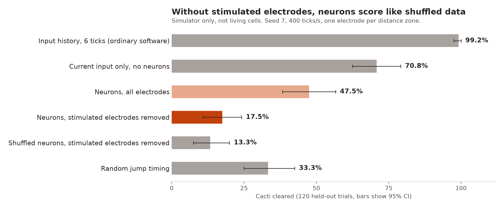

# Neurosaurus @biocomputing hack with Outlier Labs, Callosum, Cortical Labs and Frontier

**How much work are the cells actually doing?** We gave the famous dinosaur a simulated neural
network as its short-term memory, then tested whether the network was really doing anything to help.

We learned that in this simulator, it wasn't. The neurons did respond to stimulation, but reading their spikes did
worse than reading the input directly. Once we removed the stimulated electrodes from the decoder,
the score fell to the level of shuffled data, so we found no sign that the network did any useful work.

All our results come from a simulator (the `cl` SDK with a leaky integrate-and-fire backend).
Please note that in this experiment, no living cells were used for compute, and these results are not evidence about CL1 tissue.

## What we wanted to do
A cactus approaches at a random speed, and the dino must time one jump. Faster cacti need
an earlier jump relative to their distance, so a good decision should combine both speed and position.

1. Distance to a cactus is encoded as stimulation on one of 16 groups of 3 electrodes.
2. The network responds. Its weights stay fixed, and this makes it reservoir computing.
3. A logistic regression reads one tick of spike counts and then decides when to jump.

One position can't reveal speed, so a one-tick readout can only use speed if the network
holds on to earlier inputs.

## Results
600 trials: 360 training, 120 for setting the jump threshold, 120 held out for testing.
Seed 7, 400 network ticks per second, coupling gain 4 mV.

| Controller | Cacti cleared (95% CI) | Speed R² |
|---|---|---|
| Random jump tick | 33.3% (25.0-42.5) | n/a |
| Simulated network spikes, one tick | 50.0% (40.8-58.3) | 0.002 |
| Current input only | 70.8% (62.5-79.2) | 0.013 |
| Input history, 6 ticks (ordinary software) | 99.2% (97.5-100) | 0.893 |

The network scored 20.8 points below current input alone (95% CI: 13.3 to 28.3 points below).
Slower tick rates scored 38-48%. Removing coupling gave 50.8%.

## Controls: was the decoder reading our own stimulation?
The table above lets the decoder read the electrodes we stimulate, so those scores may mostly be
stimulation echoing back. We reran with two controls:

- **Stimulated electrodes removed:** the decoder never sees any electrode used for input. We
  stimulated one electrode per zone here, leaving 43 to read.
- **Shuffled spikes:** the same spikes matched to the wrong moments, which removes any link to the game.

Seed 7, 400 ticks per second, one electrode per zone:

| Decoder input | Cacti cleared (95% CI) |
|---|---|
| Neurons, all electrodes | 47.5% (38.3-56.7) |
| Neurons, stimulated electrodes removed | 17.5% (10.8-24.2) |
| Shuffled neurons, stimulated electrodes removed | 13.3% (7.5-20.0) |

- With stimulated electrodes removed, the neurons were not distinguishable from shuffled data:
  +4.2 points (95% CI: -5.0 to +13.3). Seed 11 gave +0.0 points (-9.2 to +9.2).
- Longer readings did not rescue it: at 100 and 50 ticks per second the gap was +4.2 and +0.8
  points, and both intervals included zero.
- With all electrodes, the neurons did beat shuffled data (+35.8 points). That gap disappears
  without the stimulated electrodes, so it appears to come mainly from them.
- Speed R² stayed at about zero in every neuron condition.
- Decoders with no useful signal score below random timing. They tend to jump too early, so
  shuffled data is the fairer floor here.



Our likely explanation for the lack of memory is the model's 20 ms membrane time constant, which
is short compared with the input history needed to infer speed. We did not test that directly.

## Limits
- Simulator only, with two seeds and one connectivity graph.
- Linear decoder reading one tick at a time. Ticks up to 20 ms were tested, but not a decoder
  combining several ticks.
- The controls were added after the first results, following feedback.
- The first results table used three electrodes per zone; the controls used one, because three
  would leave only 11 electrodes to read.
- The network ran faster than game time: 2.5 ms of network time per 50 ms game tick.
- Six configurations were swept on seed 42 before confirming on seed 7.
- The game replays recorded decisions. The network does not control it live.

## Next step
Run the same test on a CL1, with stimulated electrodes removed and the shuffled control included.
Our assumption is that real cultures may spread and hold information for longer. The first bar to clear is shuffled data,
and the score to beat is reading the current input. This code has not yet been run on hardware,
and stimulation rate and per-culture calibration might need adjusting.

## To Run it
Needs Python 3.13. From the repo root:

```bash
python -m venv .venv
.venv/bin/pip install -e ./biocompute-outlier-labs scikit-learn matplotlib
cd biocompute-outlier-labs
CL_SDK_ACCELERATED_TIME=1 ../.venv/bin/python experiments/neurodino.py --trials 600 --tps 400 --coupling 4 --seed 7
CL_SDK_ACCELERATED_TIME=1 ../.venv/bin/python experiments/neurodino.py --trials 600 --tps 400 --coupling 4 --seed 7 --bin-channels 1 --readout non-input
```

To play the game:

```bash
python3 -m http.server 8765 --directory game
```

Then open `http://127.0.0.1:8765/retro.html`.

The simulator and SDK setup come from
[wbmills/biocompute-outlier-labs](https://github.com/wbmills/biocompute-outlier-labs).
Our experiment is `experiments/neurodino.py` in that folder.
